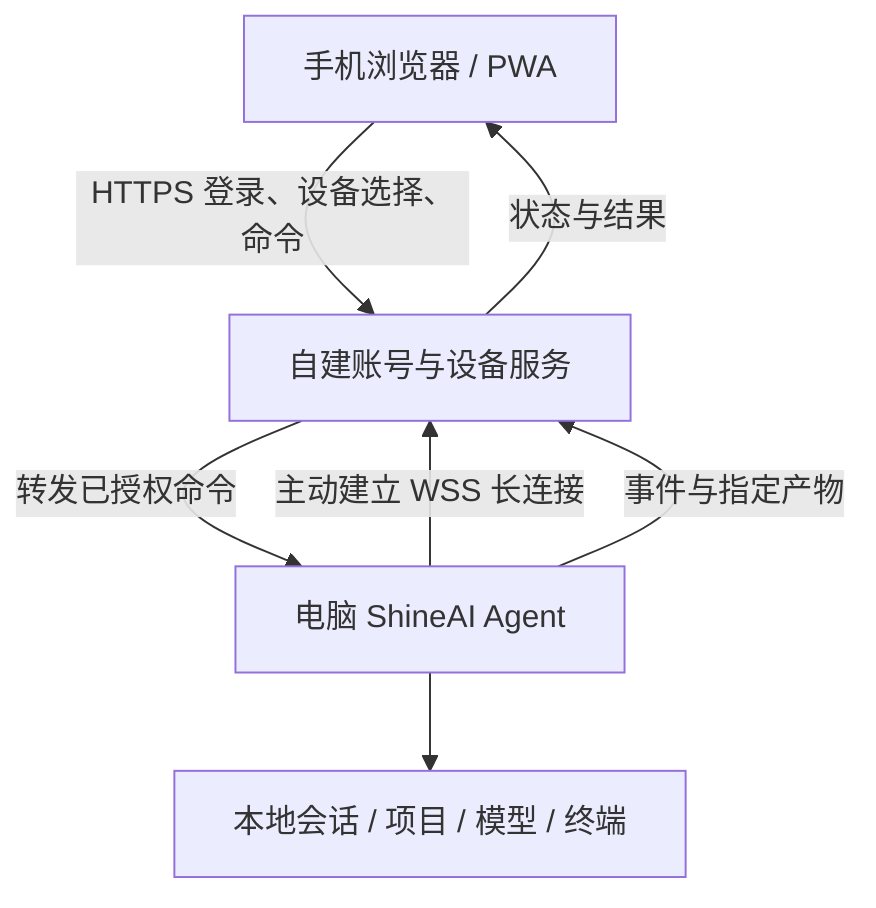

# ShineAI 手机与电脑协同方案

分析日期：2026-10-15。本轮完成架构分析，尚未实现或部署自建服务器。

## 需求理解

手机能看到自己的电脑、项目、会话和执行状态，接着发指令、停止任务、处理确认、接收文件。任务在选定的电脑执行，电脑继续使用自己的模型配置、技能、终端和工作目录。同步的是必要的会话数据和产物，不默认把整台电脑上传服务器。

这套方案可行。单纯把 Electron 工程部署到服务器，不会自动获得用户电脑里的文件与运行环境。服务器运行独立 worker 是另一种模式，需要另外准备项目、依赖和模型配置。

## WorkBuddy 官方资料核实

- [App 多端协同](https://www.workbuddy.cn/docs/workbuddyapp/features/Multidevice)
- [小程序多端协同](https://www.workbuddy.cn/docs/workbuddymini/features/Multidevice)
- [官方实践案例](https://www.workbuddy.cn/docs/workbuddy/From-Beginner-to-Expert-Guide/Practice-Cases/Practice-Six)

官方说明支持手机接续电脑会话、发送指令、停止运行、选择设备、上传照片/文件和接收产物。桌面端需允许移动端连接，电脑保持运行并联网。技能、专家、连接器及模型配置以电脑端为准；首次授权和模型密钥管理在电脑端完成。

官方 App 方案依赖同账号和设备授权。文档里的二维码用于下载或打开 App，不应把它描述成官方的配对认证方式。ShineAI 可以自行设计一次性扫码配对，但必须单独实现授权协议。

## 本项目已有能力

| 已有部分 | 现状与可复用范围 |
|---|---|
| `resources/web-client` | PWA 的 JS/CSS 发布产物，包含会话、设备、文件、任务等手机 UI；没有对应完整前端原始工程 |
| 手机请求封装 | 包含 `/api/sessions`、`/api/workspaces`、`/api/upload`、`/api/mobile/files` 等请求定义；API 名称存在不等于当前服务可用 |
| WebSocket 客户端 | 包含本地模式与旧 relay 模式，设备选择、断线重连、事件接收可作为协议对照 |
| 桌面执行层 | 本地会话、模型、终端、文件和审批可以通过明确的适配器复用 |
| 旧本地远程代码 | 有 RemoteServer、配对码及局域网相关代码；尚未逐项验收，不建议直接将其端口暴露公网 |
| 旧云服务 | 登录、中继、会员校验已从本地版停用；不会为实现自建服务而恢复旧厂商服务 |

旧网页仍包含不适合直接复用的处理：将 token 放进 WebSocket URL，并用 Base64 保存“记住的密码”。Base64 是编码，不是加密。新实现应取消保存密码，使用可撤销的设备凭证、短期访问令牌，以及 HttpOnly 会话或一次性 WebSocket 票据，并过滤访问日志中的凭证。旧订阅页面和会员判断也要换成自建权限模型。

本轮仅统一手机资源品牌，并更新 Service Worker 的文件 revision，避免改名后继续使用旧缓存；这不代表手机服务已经上线。

## 推荐架构

电脑主动向服务器连接，无须给用户电脑设置公网入站端口。服务器保存账号、设备、公钥/凭证元数据、必要的会话索引和短期事件；模型密钥留在电脑。用户授权上传的文件可以暂存对象存储，设置过期时间与下载权限。

手机端只是操作界面，服务器验证身份和归属，电脑再次验证远程开关、命令类型及工作区授权。不能把整个 Electron IPC、CDP、任意文件路径或 PTY 直接透传给手机。

## 第一版协议与权限

允许的首批命令：列出本人设备、列出已授权工作区/会话、读取会话状态、发送消息、停止运行、回答权限或计划确认、上传会话附件、读取指定产物。模型密钥和连接器首次授权继续回到桌面处理。

每条命令带 `commandId`、用户/设备/会话标识、过期时间和协议版本。区分“服务器已接收”“电脑已接收”“执行完成”；网络成功不代表任务成功。电脑按 commandId 去重，事件带递增序号，重连后补发缺失事件。停止指令优先处理。

设备断网应明确显示离线。会产生写文件、执行命令等副作用的操作默认不排队到任意未来时间；如用户选择排队，必须设置有效期并在电脑重连时重新检查授权。电脑关机、休眠或退出应用时，服务器不能代替它读取未上传的文件。

文件只能按已授权工作区和会话中的标识访问，校验规范化路径、符号链接、大小和类型，不能让手机提交任意绝对路径。多人使用时，每个用户只能操作自己绑定或明确共享的设备；本地开发身份不能作为互联网账号。

设备授权可通过账号登录后的一次性码/二维码完成，电脑端确认并开启远程开关；配对码短期有效、单次使用、限制尝试次数。撤销设备或关闭远程能力立即使凭证失效。手机锁屏通知可后续接 Web Push；微信通知需要微信侧接入，不能假设普通 PWA 自动具有该能力。

## 实施顺序

1. 固定命令/事件协议和电脑适配器，保持桌面现有功能独立可用。
2. 做单账号版本：PWA 登录、设备绑定、设备在线状态、会话接续、消息流和停止；用断线/重放场景验收。
3. 加审批、附件、产物下载、通知和设备撤销；核实多端同时操作的状态一致性。
4. 加多用户隔离、设备共享权限、审计和限流，通过跨账号越权与重连测试后再开放给其他用户。
5. 需要电脑离线仍运行时，另加服务器 worker，并让用户明确迁入项目与配置。

初期服务端可以使用 Node.js + Fastify、PostgreSQL 和 TLS 反向代理；离线队列和多实例扩容需要时再引入 Redis。资源规格和并发容量应通过真实事件量、文件传输和长连接压测确定。部署前还需要服务器、域名、TLS 和账号登录方式，这些不在本轮改名任务中执行。
